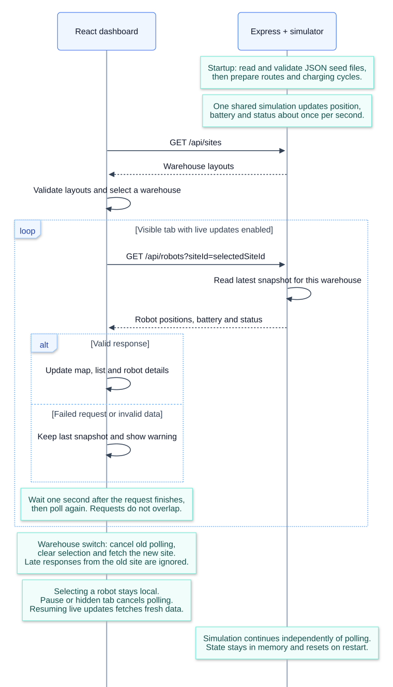

# Robot Fleet Monitor

A dashboard for monitoring robots across warehouses. 
Built as a take-home challenge covering robot simulation, a backend, and a fleet overview UI.

## Proposed Solution

The frontend is the main focus. A small Express backend runs a shared simulation and exposes the latest robot snapshots through a read-only API.

- Switch between two warehouses with different layouts.
- Select a robot from the map or list to see its status, battery and position.
- Watch moving robots follow routes, head to a charging area at 20% battery or less, and return to work when full.
- Pause updates or recover from connection failures without losing the last valid snapshot.
- Use the keyboard to select robots and navigate the dashboard. Marker animation respects reduced-motion preferences.

Warehouse layouts load once. Robot snapshots are polled for the selected warehouse, with a one-second delay after each completed request. Polling stops in hidden tabs; the backend simulation keeps running independently.

## Sequence Diagram



[Charging cycle](docs/images/charging-cycle.svg) | [Diagram source and notes](docs/sequence-diagram.md)

## Assumptions

- Sites are warehouses and robots are mobile warehouse units. Storage, loading and charging zones are traversable areas.
- JSON files seed the fleet at startup. State stays in memory and resets when the backend restarts; there is no database or real telemetry ingestion.
- Robots follow predefined routes. Initially idle or faulted robots stay put, and robots can overlap.
- This is a demo with public fixture data and no authentication. Battery drain and charging rates are accelerated to make the cycle visible.

## Libraries / Tools Used

- **Frontend:** React, TypeScript, Vite, Tailwind CSS.
- **Backend:** Node.js, Express, Zod, Swagger UI.
- **Tests:** Vitest.
- **Containers:** Docker Compose, Nginx.

## Setup

Run commands from the repository root.

### Docker

With Docker Desktop running, or Docker Engine and Compose installed:

```sh
docker compose up --build
```

Open the [dashboard](http://localhost:8080) or [Swagger UI](http://localhost:8080/api/docs/).
Nginx serves the frontend and forwards API requests to the backend, so both use the same port.

No `.env` file is required. To change the host port, copy the root `.env.example` to `.env` and set `APP_PORT`. Rebuild after source or seed data changes. Stop the stack with `docker compose down`.

### Local development

Requires Node.js 24 or later. 
In one terminal:

```sh
npm --prefix backend ci
npm --prefix backend run dev
```

In another terminal:

```sh
npm --prefix frontend ci
npm --prefix frontend run dev
```

Open the Vite URL printed in the terminal, usually `http://localhost:5173`. 
The API and [Swagger UI](http://localhost:3000/api/docs/) run on port 3000.

If you change `PORT` using `backend/.env`, set the matching `API_PROXY_TARGET` in `frontend/.env` and restart Vite. 
Examples are included in both folders. On Windows, use `npm.cmd` if PowerShell blocks `npm.ps1`.

## Running the Tests

```sh
npm --prefix frontend test
npm --prefix backend test
```

To run linting, type checks and builds:

```sh
npm --prefix frontend run lint
npm --prefix frontend run build
npm --prefix backend run lint
npm --prefix backend run typecheck
npm --prefix backend run build
```

Optional benchmarks cover fleets of 100 and 1,000 moving robots. See [performance checks](docs/performance.md) for commands, methodology and the historical results. Those results predate the battery simulation and status indicators.

## Future Work

- Detect robots getting dangerously close, then consider collision avoidance and obstacle routing.
- Model charging-station capacity and queues.
- Add real telemetry ingestion, persistence and authentication.
- Profile larger fleets before adding list virtualization or changing update delivery to SSE and partial snapshots. Multiple backend instances would also need shared state.
- Add CI checks and complete accessibility and Core Web Vitals audits.
