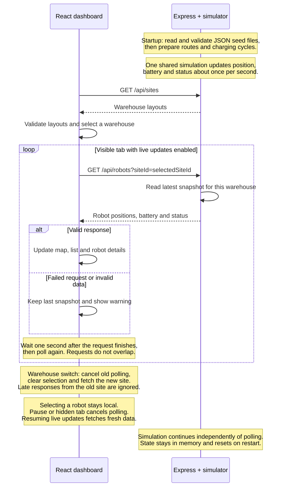
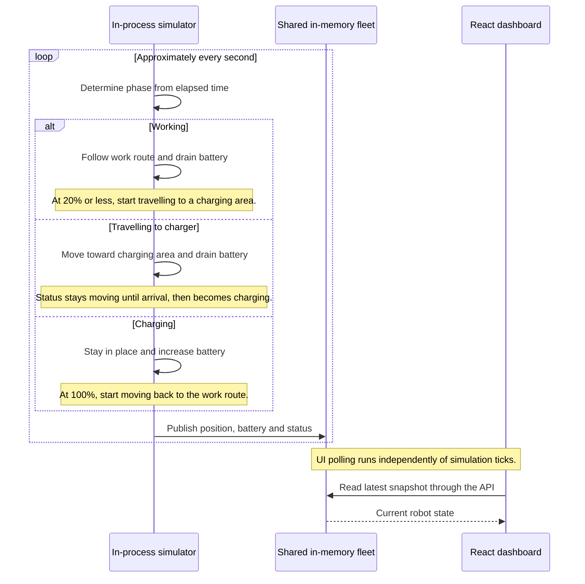

# Application flow

In Docker, Nginx serves React and forwards API requests to Express; the diagram shows those forwarded requests directly for readability. Express and the simulator share one Node.js process.

## Startup and live updates

Requests never overlap within a polling session. Switching warehouses while paused fetches one snapshot for the new warehouse and stays paused. A hidden tab makes no requests. Seed files are read at startup; simulation changes stay in memory and reset when the backend restarts.

## Automatic charging

This is a simulated cycle for a robot with a work route and a reachable charging area. The simulator calculates these phases from elapsed time; there are no commands sent to physical robots or charging services.

Moving drains 0.5 battery percentage points per second; charging restores 1 percentage point per second. Robots seeded as idle or error stay unchanged. A charging robot without a work route becomes idle when full. A moving robot that runs out of battery before reaching a charger becomes an error; charging areas have no capacity limits or queues.
